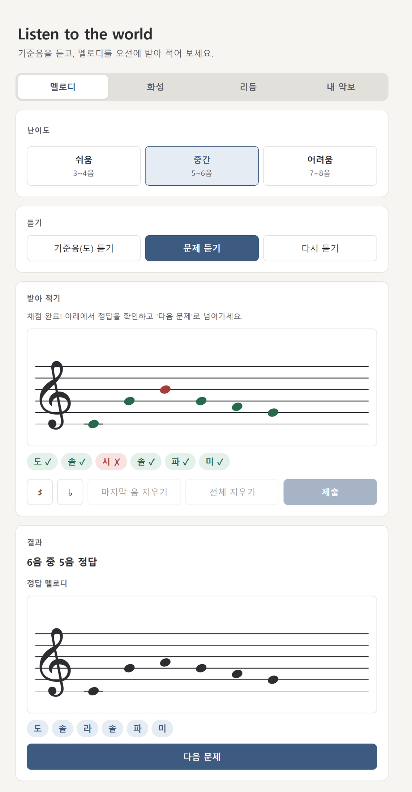
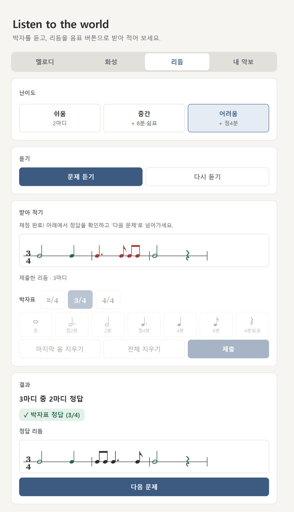
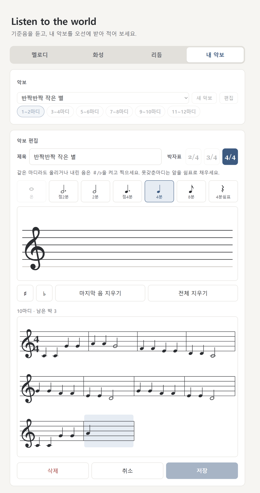
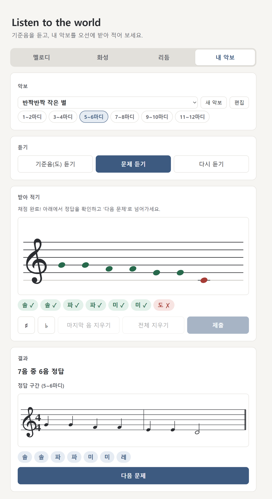
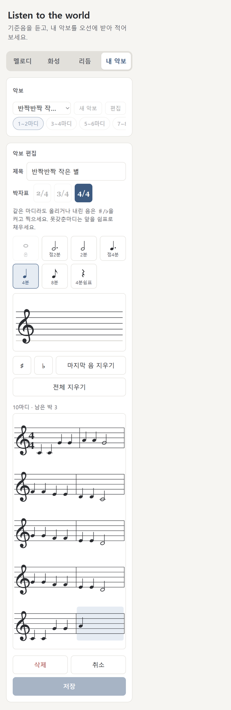

# Listen to the world — 청음 연습 웹앱

> 기준음을 듣고 멜로디·화음·리듬을 받아 적는 청음 연습 사이트. 연습하고 싶은 곡을 직접 악보로 넣거나(편집기), MusicXML 파일·악보 사진으로 불러와 구간별로 연습할 수도 있다.

- **실행 방법**: `index.html`을 더블클릭해 브라우저로 연다. 서버·설치·로그인이 필요 없다.
- **대상 브라우저**: 데스크톱 Chrome·Edge, 모바일 Chrome
- **만든 기간**: 2026-09-30 ~ 2026-11-02 (커밋 130개)
- **문서**: [요구사항 정의서 docs/PRD.md](docs/PRD.md) · [구현 Todo 리스트 docs/TODO.md](docs/TODO.md) · [녹음 출처 docs/CREDITS.md](docs/CREDITS.md)

| 목차 |
|---|
| [1. 제작한 것 소개](#1-제작한-것-소개) |
| [2. PRD와 Todo 리스트](#2-prd와-todo-리스트) |
| [3. Todo 리스트의 변경 내역](#3-todo-리스트의-변경-내역) |
| [4. 스킬](#4-스킬) |
| [5. 느낀 점, 결론](#5-느낀-점-결론) |

---

## 1. 제작한 것 소개

### 왜 만들었나

청음은 들리는 소리를 악보로 옮기는 연습이다. 핵심은 소리 하나의 이름을 맞히는 절대음감이 아니라, **기준음(도)을 잡고 그 안에서 계이름을 받아 적는 상대음감 훈련**이다. 혼자 연습하면 문제를 들려주고 채점해 줄 사람이 없다. 이 앱은 문제 듣기, 오선에 받아 적기, 어디가 틀렸는지 확인하기를 버튼 몇 번으로 할 수 있게 한다.

대표 사용자는 레슨 없는 날 집에서 혼자 청음을 연습하는 음대 입시생(가상 인물 "김서연", 18세)으로 잡았다 (PRD 3-1).

### 네 가지 모드

| 모드 | 무엇을 받아 적나 | 난이도·구성 |
|---|---|---|
| **멜로디** | 기준음 뒤 멜로디의 음높이 (3~8음) | 쉬움 3~4음 / 중간 5~6음 / 어려움 7~8음 |
| **화성** | 화음의 구성음을 오선 한 자리에 쌓기 | 3화음·7화음 각각 쉬움·중간·어려움 (자리바꿈 포함) |
| **리듬** | 음표·쉼표의 길이와 박자 | [기본 \| 심화] 각각 쉬움·중간·어려움 (심화: 16분·셋잇단·붙임줄·겹박자) |
| **내 악보** | 내가 넣은 곡의 음높이를 구간(마디)별로 | 원곡 그대로의 조·박자·음자리표, 부분 연습 |

모든 모드는 같은 흐름을 따른다: **난이도(또는 악보) 고르기 → 듣기 → 받아 적기 → 제출 → 채점과 정답 공개 → 다음 문제**.

- **채점**: 음별·구성음별·마디별로 부분 점수를 주고, 이명동음(도# = 레♭)은 정답으로 인정한다. 틀린 곳은 빨강, 맞은 곳은 초록으로 표시하고 정답을 오선이나 악보로 보여 준다. 리듬 모드는 "같은 소리를 다르게 적어도 정답"인 소리 기준으로 채점한다.
- **입력 편의**: 마우스를 올리면 입력될 음이 미리 보이고, 도(C4) 자리에 가이드 선이 있다. 지우기는 마지막 음과 전체 두 가지다. 휴대폰(320px)에서도 손가락으로 줄/칸을 누를 수 있게 크기를 맞췄다.
- **화면 고정**: 모드나 난이도를 바꿔도 "받아 적기" 영역이 위아래로 움직이지 않는다 (PRD 4-0-3). 320~1000px 11개 폭에서 자동으로 검사한다.
- **실제 악기 소리**: 피아노(기본)·바이올린·플루트·마림바·하프 녹음으로 소리를 낸다. ⚙ 설정에서 고른다.

### 차별점 — 내 악보

정해진 문제만 푸는 다른 청음 앱과 달리, **연습하고 싶은 곡을 악보로 넣어** 구간별 청음 문제로 연습할 수 있다. 이 부분이 프로젝트의 대부분(확장 4~11)을 차지한다.

| 기능 | 내용 |
|---|---|
| 원곡 악보 형식 (확장 5) | 조표·장단조, 낮은음자리표, 덧줄, 16·32분음표, 붙임줄, 셋잇단음표, 6/8 같은 겹박자, 못갖춘마디, 조·박자·빠르기 바뀜을 **곡을 바꾸지 않고** 담는다. 예시 곡: 반짝반짝 작은 별·엘리제를 위하여·그린슬리브스·산왕의 궁전에서·리듬 표기 연습곡 |
| MusicXML 불러오기 (확장 6) | MuseScore 등에서 내보낸 `.musicxml/.xml/.mxl`을 불러온다. 외부 라이브러리 없이 ZIP을 직접 풀고, 파트·성부를 골라 한 선율로 옮긴다. 화음·꾸밈음·도돌이표 기호도 담는다 |
| 편집기 (확장 7) | MuseScore처럼 커서로 음을 골라 고친다. 마디 박은 덮어쓰기 + 쉼표 채우기로 늘 맞고, 키보드 입력·되돌리기·듣기가 된다 |
| 부분 연습 | 한 줄 악보 띠에서 마디를 눌러 1·2·4마디 또는 직접 고른 구간을 연습한다. 이동도·고정도 계이름, 빠르기 75%/50% |
| 자동 계이름 (확장 10) | [보기] 화면에서 악보 전체의 음표 아래에 계이름을 자동으로 달고 인쇄(PDF 저장)할 수 있다. 결과의 정답 구간에도 계이름이 붙는다 |
| 악보 인식 (확장 11) | 인쇄 악보를 찍은 사진(여러 장)을 넣으면 **브라우저 안에서** 종이를 펴고(원근 보정) 오선·음표를 읽어 편집기로 넘긴다. 확신 없는 마디는 "확인 필요"로 표시하고, 원본 사진과 비교하며 고친다. 서버·딥러닝 모델은 쓰지 않았다 |

악보 인식 정확도(음 단위, 음높이·길이가 모두 맞은 비율)는 앱이 그린 악보 99.44%, 사진 흉내 이미지 100.00%, 공유저작물 인쇄 악보(바흐 무반주 4곡) 93.81%다.

### 화면

<table>
  <tr>
    <td align="center"><br>멜로디 — 채점 결과</td>
    <td align="center"><br>리듬(어려움) — 마디별 채점과 박자표</td>
  </tr>
  <tr>
    <td align="center"><br>내 악보 — 편집기 (확장 4 시점의 첫 편집기)</td>
    <td align="center"><br>내 악보 — 구간 채점과 정답 악보</td>
  </tr>
</table>

<p align="center"><br>휴대폰 폭(375px)</p>

> 화면 캡처는 확장 4(2026-10-08) 때 찍은 것이다. 이후 편집기(확장 7)·악보 인식(확장 11) 등이 크게 바뀌었지만 캡처는 갱신하지 않았다.

### 기술과 폴더 구조

- **HTML / CSS / JavaScript만 사용**한다. `file://`에서도 동작해야 해서 ES 모듈(`import`)과 `fetch`를 쓰지 않았다. 일반 `<script>` 태그로 파일을 붙이고, 문제 데이터와 악기 녹음(mp3를 base64로 담은 JS)도 JS 파일 안에 둔다.
- **악보**는 SVG로 직접 그린다. **소리**는 Web Audio API (실제 녹음 샘플의 높이를 바꿔 재생, 샘플 로딩 전·실패 시 합성음).
- **악보 인식**은 `<canvas>` 픽셀을 직접 처리한다(모서리 찾기, 원근 보정, 흑백화, 오선·기호 찾기). 큰 사진은 `setTimeout`으로 나눠 처리해 화면이 멈추지 않게 했다.
- 코드는 약 12,000줄(JS·CSS·HTML), 자동 테스트는 약 7,300줄이다.

```
AI-Programming-Assignment/
├── index.html              # 시작 파일 — 더블클릭으로 연다
├── README.md               # 이 문서
├── css/style.css           # 디자인, 반응형 배치, 인쇄 모양
├── js/
│   ├── app.js              # 모드 전환, 문제 출제, 재생 연결, 채점, 결과, 내 악보 흐름
│   ├── staff.js            # 오선지 그리기와 클릭 입력 (멜로디·화성)
│   ├── rhythm.js           # 리듬 보표, 음표 버튼 입력
│   ├── audio.js, sampler.js, playback.js   # Web Audio, 악기 샘플, 악보 재생 예약
│   ├── notation.js         # 악보 형식(v2) 검증·계산
│   ├── sheet.js            # 악보 그리기 (원곡 표기, 계이름)
│   ├── scores.js, settings.js              # localStorage 저장소
│   ├── score-input.js      # 내 악보 받아 적기 오선
│   ├── score-editor.js, editing.js         # 악보 편집기
│   ├── musicxml.js, unzip.js               # MusicXML/.mxl 불러오기
│   ├── omr/                # 악보 인식 (image·staff·symbols·build·photo-import)
│   └── data/               # 문제 데이터, 예시 악보, 악기 녹음
├── tests/                  # 단계별 자동 테스트 t27~t71 (+ 인식 시험 이미지 도우미)
├── tools/                  # 녹음 변환, 인식용 시험 악보 내려받기 (개발용 Python)
├── .claude/skills/         # 이 프로젝트용 스킬 4개 (4장)
└── docs/                   # PRD, TODO, CREDITS, README 캡처
```

---

## 2. PRD와 Todo 리스트

이 프로젝트는 두 문서를 기준으로 진행했다. 코드보다 문서를 먼저 고치고, 문서에 적힌 대로 구현과 테스트를 했다.

### [PRD.md](docs/PRD.md) — 요구사항 정의서

| 항목 | 내용 |
|---|---|
| 목적 | 계이름을 귀찮게 적는 일을 없애고, 청음 연습을 서포트 |
| 사용자 | 계이름과 오선을 아는 청음 연습자 (페르소나: 음대 입시생) |
| 핵심 기능 | 모드·확장별 절(4-A 멜로디 ~ 4-L 악보 인식)마다 기능, 진행 흐름, 채점 규칙 |
| 범위 밖 | 로그인, 서버 저장, 곡 검색, 손글씨·PDF 인식, 다크 모드 등 — 5번 "만들지 않는 것"에 이유와 함께 명시 |
| 기술 조건 | 서버 없이 `file://`로 동작, 일반 `<script>`, localStorage만 사용 |
| 완성 기준 | 1차와 확장 1~11마다 "이러면 성공"을 4~5개씩 정의하고 날짜와 함께 확인 완료로 표시 |
| 결정 기록 | 9번에 사용자 결정(범위, 악기, 정확도 기준 등)을 날짜와 함께 남김 |

기능을 넓힐 때마다 **PRD를 먼저 고쳐** 범위·흐름·채점 규칙·완성 기준을 정한 뒤에 Todo를 만들었다.

### [TODO.md](docs/TODO.md) — 구현 Todo 리스트

PRD를 **71단계(체크 항목 941개)** 로 나눴다. 핵심 규칙은 두 가지다.

1. **모든 [구현] 항목에는 짝이 되는 [테스트] 항목이 있다.**
2. **"완료"는 코딩이 끝난 것이 아니라 테스트까지 통과한 것이다.** 각 항목 옆에 어떻게 확인했는지(자동 테스트 개수, 확인한 폭과 브라우저, 날짜)를 남겼다.

| 범위 | 단계 | 내용 |
|---|---|---|
| 1차 — 멜로디 | 1~6 | 화면 뼈대 → 오선 입력 → 음 재생 → 퀴즈·채점 → 디자인 → 완성 기준 점검 |
| 확장 1 — 화성 | 7~11 | 모드 탭 → 화성용 오선 입력 → 화음 재생 → 화음 데이터·채점 → 점검 |
| 확장 2 — 7화음 | 12~15 | 화음 종류 선택 → 구성음 4개 → 7화음 데이터·이름 → 점검 |
| 확장 3 — 리듬 | 16~20 | 리듬 탭 → 보표·음표 입력 → 재생 → 데이터·채점 → 점검 |
| 확장 4 — 내 악보 | 21~26 | 탭·저장소 → 악보 보기 → 편집기 → 구간·재생 → 받아 적기·채점 → 점검 |
| 확장 5 — 원곡 악보 형식 | 27~34 | 악보 형식 v2 → 음높이·리듬 표기 → 원래 조·빠르기 재생 → 한 줄 악보 띠 → 받아 적기 → 점검 |
| 확장 6 — MusicXML | 35~41 | 불러오기 창 → 변환 → 형식 넓히기 → 화음 → 꾸밈음 → 도돌이표 → 점검 |
| 확장 7 — 편집기 넓히기 | 42~49 | 커서 → 음 넣기 → 붙임줄·잇단 → 마디 설정 → 화음·꾸밈음 → 기호 → 듣기 → 점검 |
| 확장 8 — 악기 소리 | 50~53 | 녹음 만들기 → 피아노 → 악기 고르기 → 점검 |
| 확장 9 — 리듬 심화 | 54~59 | 한 줄 보표 → [기본\|심화] → 입력 → 재생 → 소리 기준 채점 → 점검 |
| 확장 10 — 자동 계이름 | 60~64 | 계이름 달기 → [보기] 화면 → 인쇄 → 결과 → 점검 |
| 확장 11 — 악보 인식 | 65~71 | 사진 펴기 → 오선·세로줄 → 음높이 → 길이 → 조표·박자표 → 실제 악보 → 점검 |
| 확장 12 — 디자인·첫 방문 안내 | 72~76 | **계획만 세우고 중단** (3장) |

Todo 한 단계는 이렇게 생겼다 (23단계 일부):

```markdown
- [x] 23-5 [구현] 마지막 음 지우기 / 전체 지우기, [저장] 조건(제목 + 1마디 이상 + 마지막 마디가 다 참),
      [삭제] 두 번 눌러 확정(다른 버튼을 누르거나 3초가 지나면 확인 상태 풀림), 저장 실패 시 안내
- [x] 23-6 [테스트] 23-5 검증
  - [x] 조건이 맞을 때만 저장이 활성인가 (공백만 있는 제목은 저장 불가, 31자째는 입력되지 않음)
  - [x] 삭제 버튼을 한 번 누르면 확인 문구로 바뀌고, 다시 눌러야 지워지며, 브라우저 확인창이 뜨지 않는가
        — 23단계 자동 테스트 55개 항목, 320~1000px 11개 폭 × Edge·Chrome(file://) 모두 통과 ...
```

---

## 3. Todo 리스트의 변경 내역

처음 계획(2026-09-30, 커밋 `85cb228`)은 **멜로디 모드 한 가지, 6단계, 체크 항목 27개**였다. 확장 1~4를 끝낸 10-12에는 26단계·185개였고, 지금은 **71단계, 최상위 체크 항목 337개(하위 항목까지 941개)** 이며 전부 체크되어 있다. 확장 12(72~76단계)는 계획만 커밋하고 구현은 하지 않았다. 아래는 처음 계획과 비교해 무엇이 바뀌었는지다.

### 3-1. 범위: 하지 않기로 했던 것 → 한 것

처음 PRD의 "만들지 않는 것"에 있던 항목 중 다음이 나중에 구현으로 바뀌었다 (TODO "제외했다가 구현한 것"에 취소선으로 남아 있음).

| 처음 계획 | 바뀐 결과 | 왜 / 언제 |
|---|---|---|
| 화성(화음) 청음은 안 함 (제외-5) | 확장 1 화성 모드로 구현 | 사용자 요청 (10-01) |
| 리듬 받아적기는 안 함 (제외-4) | 확장 3 리듬 모드로 구현 | 사용자 선택 (10-05) |
| 내 악보는 다장조·C4~G5·7종 음표·12마디·못갖춘마디 없음 (제외-12) | 확장 5에서 조표·낮은음자리표·붙임줄·셋잇단·못갖춘마디·마디 수 제한 없음까지 | 사용자 결정 (10-31): "앱은 곡을 바꾸지 않는다". 틀에 곡을 맞추지 않고 틀을 넓힘 |
| 새 형식 편집기는 없음 (제외-19) | 확장 7에서 모든 표기를 넣고 고치는 편집기 | 확장 5·6 형식이 생기며 필요해짐 (10-31) |
| 리듬의 16분음표·셋잇단·붙임줄·겹박자는 다음 확장으로 미룸 (제외-10) | 확장 9 리듬 [기본\|심화] | 계획 (11-01) |
| 악보 자동 계이름 표시는 "다음 단계로 미룸" (제외-3, 처음엔 MusicXML 업로드와 한 묶음) | 확장 10 [보기] 화면·인쇄·결과 | 계획 (11-01) |
| 꾸밈음·도돌이표는 확장 6에서 정함 (제외-18) | 꾸밈음은 담아서 그리고 재생하고 **받아 적기에도 포함**, 도돌이표는 기호만 그림 | 처음엔 꾸밈음을 빼기로 했다가 같은 날 사용자가 "들리는데 정답에 없으면 헷갈린다"며 포함으로 바꿈 (10-31) |

### 3-2. 로드맵(확장 순서)이 바뀐 것

| | 처음 계획 | 실제 |
|---|---|---|
| 확장 5 | MusicXML 불러오기 | **원곡 악보 형식** (MusicXML이 들어올 그릇을 먼저 만듦) |
| 확장 6 | 악보 인식(OCR)·곡 검색 | **MusicXML 불러오기** |
| 확장 7 이후 | — | 편집기 넓히기 → 실제 악기 소리 → 리듬 심화 → 자동 계이름 → 악보 인식 (계획에 없던 것들이 사용자 결정으로 추가) |
| 곡 검색 | 확장 후보 | **하지 않음** (11-01 사용자 결정: 저작권 있는 곡의 악보를 제공하기 어렵고 서버가 필요) |
| 악보 인식 방식 | 외부 라이브러리·OCR 가정 | 조사 결과 브라우저에서 쓸 라이브러리가 없고(라이선스 불명, Python·Java, 모델 109MB) 서버도 못 쓰므로 **직접 만든 영상 처리**로 결정 |

### 3-3. 기능을 수정한 것

| 항목 | 처음 → 바뀜 | 이유 |
|---|---|---|
| 같은 제목의 악보 (4-E) | 허용 → 편집기는 **저장 금지**, MusicXML 불러오기는 " (1)" 번호 붙임 (개선-8·10) | 사용자 요청 (10-31) |
| 꾸밈음 재생 (개선-4) | 0.09초 → 종류별 관례(사선 0.03초 앞에서, 짧게 적힌 건 붙여 침, 긴 앞꾸밈음은 뒤 음의 시간을 빌림) | 사용자가 소리를 듣고 "투둑투둑", "따로 들린다", "더 줄여 줘"를 세 번 지적. 끊기지 않게 소리를 이어 붙이도록 audio.js도 고침 |
| 마디 쉼표 (개선-6) | 3/4에서 점2분쉼표 → 박자와 관계없이 가운데 온쉼표 | 실제 곡(모차르트 트리오)과 비교하다 발견. 같이 마디 폭을 음표 수가 아니라 박자 길이로 나누도록 고쳐 못갖춘마디 폭 버그 해결 |
| 편집기 키보드 | 잇단음표 Ctrl+3 (MuseScore와 같음) → **Alt+3** | 브라우저가 Ctrl+숫자를 탭 이동에 써서 동작하지 않음 (44단계) |
| 리듬 보표 | 보표 위 x 음표머리 → **일반 음표머리 한 줄 보표**, 기본도 같은 그림으로 통일 | x머리로는 2분·4분 구분이 안 됨. 통일은 사용자 요청 (확장 9) |
| 리듬 채점 | 표기 그대로 비교 → **소리 기준** | 4분음표와 8분⌒8분처럼 같은 소리를 다르게 적어도 정답으로 (확장 9) |
| 악기 음역 밖의 음 | (미정) → 가장 가까운 녹음을 늘려서 냄 | 다른 사례를 듣고 사용자 결정 (확장 8) |
| 인식 정확도 기준 | 공유저작물 악보 **95% → 90%** | 사용자 결정 (11-02). 실제 악보 글꼴과 1차에서 읽지 않는 표기가 섞인 곡이라 93.81%가 나옴. 대신 "틀린 음이 든 마디는 모두 확인 필요로 표시(빠뜨린 마디 0)" 기준은 그대로 지킴 |
| 예시 악보 | 하바네라·볼가강의 뱃노래 → **리듬 표기 연습곡**(이 앱용, 실제 곡 아님) | 기억으로 정확히 옮길 수 없어 사용자가 대체하기로 결정 (10-31). 새 곡은 악보와 소리를 사용자가 확인 |
| 단조 기준음 | (미정) → 으뜸음 "라" | 이동도 관례 (확장 5) |

### 3-4. 단계 사이에 새로 넣은 항목 (처음 계획에 없던 것)

- **작은 화면 개선 (개선-1~3, 10-04)**: 360px 이하에서 줄/칸 간격 확보, 난이도 설명 한 줄 고정, 휴대폰 폭에서 부제목 자리 고정. 사용자가 휴대폰에서 써 보고 요청.
- **"개선-N" 항목 11개**: 위 표의 꾸밈음·마디 쉼표·제목 중복 등. 진행 중 사용자가 요청하면 코드를 바로 고치지 않고 먼저 TODO에 `개선-N [구현]/[테스트]`를 추가한 뒤 같은 규칙으로 처리했다.
- **회귀 테스트 항목**: 단계가 늘수록 "기존 자동 테스트가 모두 통과하는가"가 모든 단계에 붙었다. 후반 단계로 갈수록 단계마다 t27~tN 전체를 Edge·Chrome 11개 폭에서 다시 돌렸다.
- **단계 안의 임시 상태**: 27~32단계 동안 새 예시 곡은 목록에 보이되 연습은 잠겨 있었고, 66~68단계의 악보 인식은 쉼표·4분음표·4/4·다장조 같은 임시 값으로 두었다가 69~70단계에서 없앴다. 임시 값은 확장 머리말에 적고 없애는 단계를 명시했다.

### 3-5. 테스트 뒤에 생긴 변화 (테스트·확인이 찾아낸 문제)

| 단계 | 찾은 문제 | 처리 |
|---|---|---|
| 16 | 482~680px 폭에서 멜로디↔화성을 바꾸면 오선지가 56px 어긋남 (이전부터 있던 문제) | 듣기 버튼 2열 배치 기준을 480 → 680px로 넓힘 |
| 17 | 481~560px에서 리듬 보표 4마디가 한 줄에 들어가 8분음표가 겹침 | 줄 나눔 기준을 화면 폭 대신 보표 상자 폭으로 바꿈 |
| 22 | 아래로 난 기둥의 8분음표 꼬리가 거꾸로 달림 | 방향을 고치고 꼬리 방향 테스트를 추가 |
| 23 | 입력 중인 마디의 강조 상자가 오선을 가림 | 강조 상자를 오선 뒤로 |
| 24 | 데스크톱에서 구간 칩 줄의 스크롤바가 칩 높이를 줄임 | 스크롤바를 숨기고 마우스 휠로 가로 스크롤 |
| 40 | 3/4 마디 쉼표가 점2분쉼표로 그려지고, 못갖춘마디가 짧게 그려지지 않음 | 개선-6 (위) |
| 65 | 손잡이를 누를 때 포커스가 페이지를 스크롤해 터치 끌기가 어긋남 | `focus({ preventScroll: true })` |
| 66 | 사진을 펴면 끝세로줄의 가는 선과 굵은 선이 붙어 보통 세로줄로 읽힘 | 보통 세로줄보다 2.5배 넘게 굵으면 끝세로줄 |
| 67 | 덧줄이 있는 곳의 다섯 줄을 오선으로 잘못 잡아 보표가 밀림 | 이웃 띠와 어긋난 띠는 버리고 보간 |
| 69 | 세로줄 옆의 음표 머리가 세로줄을 기둥으로 삼아 세로줄이 사라짐 | 기둥 끝에 머리가 있는지를 0.3칸 안에서만 인정 |

테스트가 실패했을 때 앱부터 고치지 않고 먼저 시험 데이터를 확인하는 규칙도 이 과정에서 생겼다("정확히 8음"이라던 시험 악보가 실제로는 9음이어서 거짓 실패가 난 적이 있다).

### 3-6. 확장 12(디자인 개편·첫 방문 안내) — 계획만 하고 중단

2026-11-02에 "음악을 모르는 사람도 대충 따라 할 수 있게" UI를 다듬고, 처음 들어올 때 주변을 어둡게 하고 한 곳씩 가리키는 안내(코치 마크)를 넣는 확장 12(PRD 4-M, TODO 72~76단계)를 계획했다(커밋 `7d58fe4`). 72단계(색·버튼·안내 문구·결과 배지)를 구현하고 그 단계 테스트는 통과했지만, 전체 회귀 테스트를 끝내기 전에 사용자가 이번 확장을 진행하지 않기로 해 **구현은 되돌렸고(체크·커밋 없음) 계획 문서만 남겼다.** 이 계획에서 구현 전에 찾은 빈칸은 두 가지다: ① 첫 방문 안내가 생기면 기존 테스트 전체가 안내에 막히므로 테스트 러너가 "봤음"을 미리 넣어야 한다, ② 편집 중 안내 다시 보기를 누르면 저장하지 않은 편집이 사라지므로 편집·보기 화면에서는 잠가야 한다.

---

## 4. 스킬

이 프로젝트에서는 **직접 만든 스킬 4개**를 썼다 (`.claude/skills/`, 2026-10-31 `a0dc0bc` "프로젝트 스킬 추가"). 외부에서 가져온 스킬은 쓰지 않았다. 만든 이유는 같다: 이 프로젝트의 작업 방식(PRD → 계획 검토 → TODO → 단계 실행 → 테스트 → 커밋)이 단계마다 똑같이 반복되는데, 새 대화가 시작될 때마다 규칙을 다시 설명하고 임시 폴더에 두었던 테스트 러너가 사라져 다시 찾아야 했기 때문이다 (세션이 바뀌면 맥락이 끊기는 문제). 규칙을 스킬로 저장소에 넣으면 어떤 세션에서도 같은 방식으로 일한다.

| 스킬 | 만든 이유 | 쓰인 곳 |
|---|---|---|
| `ltw-extension-plan` | 확장마다 "PRD를 먼저 고치고 → 계획을 코드와 맞춰 보고 → TODO를 만든다"는 순서와 양식(`assets/prd-section.md`, `assets/todo-stage.md`)이 같다. 순서를 빼먹지 않고, 사용자가 범위를 정하기 전에 확정하지 않도록 | 확장 5~12의 PRD 절·TODO 단계 작성. 계획 검토 체크리스트로 음악 규칙·상한·file:// 제약·화면 고정 같은 빈칸을 구현 전에 찾음 |
| `ltw-stage-workflow` | "구현 → 짝 테스트 통과 → TODO 체크와 근거 기록 → 커밋 → 보고 후 멈춤"을 한 단계씩 지키게 함. "완료=테스트 통과"와 사람만 할 수 있는 확인(🔈 청취, 실제 기기)을 AI가 통과로 처리하지 못하게 막음 | 27~71단계 전부. TODO의 근거 문구("N개 항목, 11개 폭 × Edge·Chrome 모두 통과")가 이 스킬의 형식 |
| `ltw-test-runner` | 처음 만든 헤드리스 테스트 러너가 세션이 바뀌며 임시 폴더와 함께 사라진 적이 있어 저장소에 넣음. 320~1000px 11개 폭 × Edge·Chrome을 자동으로 돌림 | 모든 단계의 [테스트] 항목, 단계마다 전체 회귀. 스킬의 `scripts/`에 러너(run.py)·도우미(lib.js)·모드 한 사이클 회귀(smoke.js), `references/`에 함정 모음 |
| `ltw-commit` | 커밋 메시지 형식("N단계 코드 생성 및 테스트 완료" 등)을 일정하게 하고, `git add -A`로 임시 파일이 섞이는 것을 막음. 10-31에 사용자 지시로 "단계가 끝나면 승인을 묻지 않고 바로 커밋(푸시는 안 함)"으로 고침 | 스킬을 만든 10-31 이후의 커밋. 그 전에도 같은 형식으로 손으로 썼고, 스킬이 이 형식을 굳혔다 |

아래는 네 스킬의 `SKILL.md` 전문이다.

### 4-1. ltw-extension-plan

<details>
<summary><code>.claude/skills/ltw-extension-plan/SKILL.md</code> 전문 보기</summary>

````markdown
---
name: ltw-extension-plan
description: Listen to the world 앱에 새 확장(새 모드나 기능, 예: 확장 5 MusicXML 불러오기)을 더할 때 PRD를 먼저 고치고, 계획을 실제 코드와 맞춰 빈칸을 찾고, docs/TODO.md에 [구현]/[테스트] 짝으로 된 단계를 만듭니다. "확장 5 계획 세워 줘", "새 기능 PRD 써 줘", "TODO 만들어 줘", "다음 확장 뭐 할까", 계획 검토를 요청할 때 사용합니다. 이미 계획된 단계를 실행하는 일(ltw-stage-workflow)에는 사용하지 않습니다.
---

# 새 확장 계획 (PRD → 검토 → TODO)

이 프로젝트는 확장할 때마다(화성, 7화음, 리듬, 내 악보) **PRD를 먼저 고치고**, 계획을 검토한 뒤에 TODO를 만들었다.
무엇을 만들지와 범위는 사용자가 정한다. Claude는 초안을 쓰고, 선택지와 그 근거를 보여 준다.

## 순서

1. **현황 확인**: `docs/PRD.md`의 1번(일정), 5번(범위 제외), 10번(완성 기준), 11번(로드맵)과 `docs/TODO.md`의 "하지 않기로 한 것"을 읽는다.
   다음 확장 번호, 다음 PRD 절 문자(4-F …), 다음 단계 번호(27 …)를 정한다.
2. **범위 정하기**: 정할 것을 선택지로 묶어 사용자에게 묻는다(한 번에 4개 이하). 무엇을 넣고 무엇을 빼는지, 난이도 구성, 저장 방식, 예시 데이터 같은 것들이다.
   각 선택지에는 "왜 그런지"(입시 형식, 기존 코드 재사용, file:// 제약)를 붙인다. 사용자가 고르기 전에 범위를 확정하지 않는다.
3. **PRD 고치기**: `assets/prd-section.md` 양식으로 4-X 절을 쓴다. 그와 함께 아래도 고친다.
   - 1번 일정: `- 확장 N(이름): 진행 중`
   - 4-0 공통: 탭이 늘거나 화면 구성이 바뀌면 고친다
   - 5번 범위 제외: 이번에 빼기로 한 것을 "확장 N은 …에서 시작"처럼 이유와 함께 적는다
   - 7번 기술 조건: 새 제약이 생기면 적는다
   - 9번 결정 사항: 사용자가 2번에서 고른 결정을 적는다
   - 10번 완성 기준: 확장 N 기준 4~5개를 적는다
   - 11번 로드맵: 이번 확장을 지우고 그다음을 적는다
4. **계획 검토(빈칸 찾기)**: 아래 체크리스트로 PRD 초안을 실제 코드와 대조한다. 찾은 빈칸은 사용자에게 보고하고, 정해지면 PRD에 반영한다.
5. **TODO 만들기**: `assets/todo-stage.md` 양식으로 `# 확장 N — 이름` 머리말과 단계들을 쓴다. "하지 않기로 한 것"에 새 제외 항목(`제외-16` …)을 더한다.
6. **사용자 확인**: PRD와 TODO의 변경 요약(새 절, 단계 목록, 제외 항목, 검토에서 찾은 빈칸)을 보고하고 승인을 기다린다. 승인 전에는 코드를 쓰지 않는다.
   승인되면 메모리의 진행 상황 메모에 "확장 N 계획 확정, TODO A~B단계"를 적는다.

## 단계 나누는 법

- 지난 확장들의 흐름을 따른다: **탭·화면 뼈대 → 입력 → 재생 → 데이터·채점·결과 → 완성 기준 점검**. 확장 4는 저장소 → 보기 → 편집기 → 구간·재생 → 받아 적기·채점 → 점검이었다.
- 한 단계는 사용자가 화면이나 소리로 확인할 수 있는 결과 하나다(단계 목표 한 문장 + **확인 방법**).
- 모든 [구현] N-k 바로 다음에 [테스트] N-(k+1)을 둔다. 테스트 하위 항목은 "~하는가?"로 끝나는, 자동이나 사람이 판정할 수 있는 문장으로 쓴다.
- 단계마다 테스트에 "기존 모드 한 사이클 회귀"를 넣는다. 화면 배치가 바뀌는 단계에는 "320~1000px에서 받아 적기 영역 위치가 같은가"를 넣는다.
- 소리 확인은 🔈, 사람만 할 수 있는 확인(Edge 실제 창, 더블클릭, 실제 휴대폰)은 그 항목에 그렇다고 적는다.
- 다음 단계 전까지 임시로 쓰는 것(샘플 데이터, 잠긴 화면)은 확장 머리말에 적고, 언제 없애는지도 적는다.
- 마지막 단계는 항상 "확장 N 완성 기준 점검"이다. 10번 기준 하나당 항목 하나를 둔다.

## 계획 검토 체크리스트

확장 4 때 이 검토로 실제 악보 규칙(임시표가 마디 끝까지 이어짐), 상한과 예시 곡의 충돌(8마디 상한 vs 12마디 곡), 못갖춘마디 문제를 구현 전에 찾았다.

- **음악 규칙**: 실제 악보나 입시 청음에서 쓰는 표기·관례와 어긋나지 않는가(임시표, 기둥 방향, 박자, 이명동음 채점)? 사용자가 "악보에 보이는 대로" 적었을 때 정답으로 처리되는가?
- **상한과 데이터**: 개수·길이 상한이 예시 데이터, 난이도별 문제 수(5개 이상), 화면 폭(320px에 몇 개 들어가는지)과 충돌하지 않는가?
- **기존 코드 재사용**: 재사용하려는 함수가 실제로 그 일을 하는가? 파일과 함수 이름을 직접 찾아 확인한다. `Staff.create`의 `onPick`/`topStep`, `Rhythm.TYPES`, `Score.sections`, `Scores.isValid` 같은 것들이다.
- **file:// 제약**: `fetch`·`import`·서버가 필요한가? 파일을 읽어야 하면 `<input type="file">` + FileReader만 쓴다. 외부 라이브러리가 필요하면 저장소에 파일로 넣을 수 있는가?
- **화면 고정**: 새 패널이나 문구 때문에 모드를 바꿀 때 받아 적기 영역이 움직이지 않는가? 안내 문구 자리를 미리 고정해 두었는가?
- **저장소**: localStorage 키 버전, 예전 데이터와의 호환, 저장 실패 시 동작이 정해져 있는가?
- **경계 사례**: 빈 입력, 최대치, 지원하지 않는 입력(예: MusicXML의 16분음표·붙임줄·여러 파트), 같은 문제가 반복될 때의 동작이 PRD에 적혀 있는가?
- **완성 기준**: 각 기준을 TODO의 어느 단계·항목으로 확인하는지 연결되는가?

## 예외 상황

- **사용자가 범위 밖 기능을 바로 요청할 때**: PRD 5번에 있는 기능이면 그 사실을 알리고, 확장으로 계획할지 묻는다. 계획 없이 코드로 넘어가지 않는다.
- **아주 작은 개선**(버튼 크기, 문구 하나): 확장으로 만들지 않고, 진행 중인 확장의 TODO에 `개선-N [구현]`/`[테스트]` 항목으로 넣는다.
- **조사가 필요한 결정**(예: .mxl 압축 해제를 서버 없이 할 수 있는지): PRD 9번에 "열린 질문"으로 적고, 조사 결과를 보고한 뒤에 사용자가 결정하게 한다.
````

</details>

### 4-2. ltw-stage-workflow

<details>
<summary><code>.claude/skills/ltw-stage-workflow/SKILL.md</code> 전문 보기</summary>

````markdown
---
name: ltw-stage-workflow
description: Listen to the world 프로젝트에서 docs/TODO.md에 이미 계획된 단계를 이 프로젝트의 규칙대로 실행합니다(구현 → 짝 테스트 통과 → TODO 체크와 근거 기록 → 커밋 → 보고 후 멈춤). "N단계 진행해", "다음 단계 하자", "27-3 구현해", "TODO 체크해 줘", 단계 결과 보고를 요청할 때 사용합니다. 새 확장의 PRD·TODO를 새로 짜는 일(ltw-extension-plan)이나 커밋(ltw-commit)에는 사용하지 않습니다.
---

# TODO 단계 실행 규칙

TODO.md 머리말에 합의된 방식이다. **"완료"는 코딩이 끝난 것이 아니라 테스트까지 통과한 것이다.**
한 번에 한 단계만 진행한다. 단계가 끝나면 보고하고, 사용자가 확인하기 전에는 다음 단계를 시작하지 않는다.

## 순서

1. **단계 읽기**: `docs/TODO.md`에서 해당 단계의 단계 목표, 항목, **확인 방법**을 읽는다.
   확장 머리말(`> PRD #4-X. …`)과 그 단계가 가리키는 PRD 절(`PRD #4-X-n`)도 함께 읽는다.
   코드를 쓰기 전에 메모리와 git log로 앞 단계가 실제로 끝났는지 확인한다.
2. **짝 맞추기**: [구현] N-k마다 [테스트] N-(k+1)이 있는지 본다. 테스트 항목이 없거나 모호하면 구현 전에 사용자에게 묻는다. 임의로 범위를 넓히지 않는다.
3. **구현**: 기존 코드 관례를 따른다.
   - `file://`에서 동작해야 한다. ES 모듈(`import`)과 `fetch`는 쓰지 않는다. 새 파일은 일반 `<script>` 태그로, 의존하는 파일 다음 순서에 붙인다.
   - 데이터는 `js/data/`에 둔다. 문서에 쓰는 이미지는 `docs/images/`에 둔다.
   - PRD "범위 제외"나 TODO "하지 않기로 한 것"에 있는 기능은 만들지 않는다.
4. **테스트**: ltw-test-runner 스킬로 단계 테스트(`tests/tNN.js`)와 `smoke.js` 회귀 테스트를 Edge·Chrome 11개 폭에서 돌린다. FAIL이 0이 될 때까지 고친다.
5. **TODO 갱신**: 통과한 항목만 `- [ ]` → `- [x]`로 바꾸고, 항목 끝에 ` — ` 뒤로 근거를 붙인다(아래 형식).
   자동화할 수 없는 항목은 체크하지 않고 사용자 확인을 기다린다.
6. **커밋하고 보고하고 멈춤**: ltw-commit 스킬의 메시지 형식과 파일 고르기 규칙대로 승인을 묻지 않고 바로 커밋한다(2026-10-31 사용자 지시). 그다음 아래 보고 형식으로 알리고(커밋 해시·메시지 포함) 대기한다. 푸시는 하지 않는다.
7. **메모리 갱신**: 단계가 끝났거나 중간에 멈추면 진행 상황 메모를 갱신한다(어디까지 끝났는지, 남은 사용자 확인 항목, 다음 단계).

## TODO 근거 형식

무엇으로, 어디서, 몇 개를, 언제 확인했는지를 적는다. 확인하지 못한 것도 숨기지 않고 적는다.

```markdown
- [x] 25-4 [테스트] 25-3 검증 — 25단계 자동 테스트 42개 항목(+ smoke 30개), 320~1000px 11개 폭 × Edge·Chrome(file://) 모두 통과 (2026-10-08)
  - [x] 데스크톱 Edge 실제 창에서 확인 — 사용자 직접 확인 (2026-10-08)
  - [x] 휴대폰 폭(320~412px) — 헤드리스 틀로 확인. 실제 Chrome 창은 최대화 상태라 폭을 줄여 보지 못함
```

## 사람만 할 수 있는 확인

다음 항목은 Claude가 통과로 처리하지 않는다. 보고할 때 목록으로 요청한다.
- 🔈 소리 청취: 탁하지 않은지, 리듬이 자연스러운지. 자동 테스트는 예약된 시각과 음높이까지만 확인한다.
- 데스크톱 Edge 실제 창
- `index.html` 더블클릭 실행
- 실제 휴대폰

사용자가 "확인했어"라고 하면 그 항목을 `— 사용자 직접 확인 (날짜)`로 체크한다.

## 보고 형식

```
N단계 완료 보고
- 완료: N-1 ~ N-6 (모두 테스트 통과)
- 근거: 자동 테스트 n개 항목 + smoke, 11개 폭 × Edge·Chrome 모두 PASS
- 고친 문제: (테스트 중 찾은 앱 버그나 기존 문제가 있으면 무엇을 어떻게 고쳤는지)
- 사용자 확인 필요: 🔈 N-4 화음이 탁하지 않은지 / Edge 실제 창 / …
- 커밋: abc1234 N단계 코드 생성 및 테스트 완료
- 다음: N+1단계 — (단계 이름)
```

## 예외 상황

- **테스트가 계속 실패해 단계 안에서 해결할 수 없을 때**: 체크하지 않고 "N-4 미완: 원인 …"으로 보고한다. 테스트를 느슨하게 고쳐 통과시키지 않는다.
- **진행 중에 사용자가 새 요청을 할 때**(예: "320px에서 버튼이 좁아"): 바로 코드를 고치지 말고, TODO에 항목(예: `개선-4 [구현]` + `[테스트]`)을 먼저 추가한 뒤 같은 규칙으로 처리한다.
- **계획과 코드가 맞지 않을 때**(TODO에 적힌 함수나 구조가 없는 경우): 임의로 해석하지 말고 사용자에게 알린 뒤 TODO를 먼저 고친다.
- **확장의 마지막 단계(완성 기준 점검)**: PRD 10번의 해당 확장 기준을 하나씩 확인한다. 모두 통과하면 PRD 1번 일정, 10번 기준, TODO 확장 제목에 "완료"와 날짜를 적는다.
````

</details>

### 4-3. ltw-test-runner

<details>
<summary><code>.claude/skills/ltw-test-runner/SKILL.md</code> 전문 보기</summary>

````markdown
---
name: ltw-test-runner
description: Listen to the world 청음 앱을 헤드리스 Edge·Chrome으로 320~1000px 여러 화면 폭에서 자동 테스트합니다. TODO 단계의 [테스트] 항목 검증, 테스트 작성·실행, 회귀 테스트, 화면 폭별 배치 점검, "테스트 돌려 줘"를 요청할 때 사용합니다. 소리 청취 확인이나 사람이 실제 기기로 하는 확인은 대신하지 않습니다.
---

# Listen to the world 자동 테스트

`index.html`을 임시 폴더로 복사해 `file://`로 열고, 화면 폭마다 iframe을 하나씩 띄워 테스트를 돌린다.
가상 시간(`--virtual-time-budget`)으로 재생 대기를 빨리 감기 때문에 11개 폭 전체도 수 초면 끝난다.
설치할 것은 없다(Python 3, Edge 또는 Chrome만 있으면 된다).

## 실행

프로젝트 루트(`index.html`이 있는 폴더)에서 실행한다.

```bash
python .claude/skills/ltw-test-runner/scripts/run.py tests/t27.js .claude/skills/ltw-test-runner/scripts/smoke.js
python .claude/skills/ltw-test-runner/scripts/run.py tests/t27.js --browser chrome
python .claude/skills/ltw-test-runner/scripts/run.py tests/t27.js --widths 375,1000 --verbose   # 빠른 확인
```

- 기본 폭: 320, 360, 375, 412, 480, 520, 600, 680, 768, 900, 1000 (11개). 480px 이하에서는 스크롤바를 숨겨 휴대폰과 같은 폭으로 배치한다.
- 출력: FAIL 줄만 `[width N]`을 붙여 보여 주고, 마지막에 `PASS n / FAIL m`을 보여 준다. 모두 PASS일 때만 종료 코드가 0이다. `--verbose`를 주면 PASS 줄도 보인다.
- 빈 브라우저 프로필로 열고, 폭마다 페이지를 열 때 localStorage를 비운다(iframe끼리 저장소를 함께 쓰므로). 내 악보는 예시 악보부터 시작한다. 테스트에서 저장소를 바꿨다면 끝에 `localStorage.removeItem(Scores.STORAGE_KEY)`로 되돌리고, 고른 악보도 첫 악보로 돌려놓는다(뒤에 도는 smoke.js가 영향을 받는다).
- `--head <파일.js>`: 앱 스크립트보다 먼저 실행할 스크립트. 예전 저장값(v1)이 있는 브라우저처럼, 앱이 열리기 전 상태를 만들 때 쓴다(예: `--head tests/t27-v1.head.js tests/t27-v1.js`). 폭마다 iframe이 새로 열릴 때 다시 실행된다.

## 단계 테스트를 쓰는 순서

1. TODO의 [테스트] 항목을 하나씩 `T.check`로 옮긴다. check 메시지에는 항목 번호나 내용을 적는다.
2. 파일은 `tests/tNN.js`(NN = 단계 번호)로 저장소에 둔다. 다음 세션에서도 다시 돌릴 수 있어야 한다.
3. 단계 테스트와 `scripts/smoke.js`(4개 모드를 한 사이클씩 도는 회귀 테스트)를 **항상 함께** 돌린다.
4. Edge 11개 폭으로 돌리고 Chrome 11개 폭으로도 돌린다. 둘 다 FAIL 0이어야 완료다.
5. FAIL이 나면 앱부터 고치지 말고, 먼저 테스트 데이터와 기대값이 맞는지 확인한다. 예전에 "정확히 8음"이라던 시험 악보가 실제로는 9음이어서 거짓 실패가 난 적이 있다.

테스트 파일 모양:

```js
T.test('27-2 파일 선택 후 악보 목록에 추가', async (T) => {
  T.setMode('score');
  T.check(T.$('score-select').options.length === 1, '처음에는 예시 악보 1개');
  // ...
});
```

## T 도우미 (scripts/lib.js)

| 도우미 | 하는 일 |
| --- | --- |
| `T.test(name, fn)` / `T.check(cond, msg)` | 테스트 등록 / PASS·FAIL 한 줄 기록. 예외가 나면 그 테스트는 FAIL로 기록되고 다음 테스트로 넘어간다 |
| `T.setMode('melody'·'harmony'·'rhythm'·'score')`, `T.setLevel`, `T.setChordType('triad'·'seventh')` | 탭과 버튼을 실제로 클릭한다 |
| `await T.listen()` | "문제 듣기"를 누르고 재생이 끝나 입력이 풀릴 때까지 기다린다 |
| `T.unlock()` | 재생 없이 현재 모드의 입력만 푼다(입력 동작만 볼 때) |
| `T.enterNotes(notes, container?)` | `[{step, accidental}]`를 ♯/♭ 토글과 오선 클릭으로 입력한다. `current`를 넘기면 정답이 입력된다. 내 악보에서는 `current`가 음높이(`{step:'F', alter, octave}`)이고 새 받아 적기 오선(`scoreInput`)에 입력한다(`T.enterPitch`) |
| `T.clickStep(step, container?)`, `T.hoverStep` | step(0 = C4 … 11 = G5) 위치를 클릭하거나 마우스를 올린다. 편집기 입력판은 `T.$('editor-pad')`를 넘긴다 |
| `T.enterRhythm(['q','e','e','h'])`, `T.setTime(3)` | 리듬 음표 버튼과 박자표 버튼을 누른다 |
| `T.submit()`, `T.next()`, `T.resultText()` | 제출, 다음 문제, 결과 영역 텍스트 |
| `T.wait(ms)`, `await T.waitFor(cond, timeout)` | 기다리기. 가상 시간에서도 똑같이 동작한다 |
| `T.noHorizontalOverflow()` | 가로 스크롤이 생기지 않았는지 |

앱의 최상위 변수와 객체는 테스트에서 바로 읽을 수 있다.
- 상태: `mode`, `level`, `chordType`, `current`, `chord`, `section`, `submitted`, `scoreId`
- 앱 객체: `staff`, `rhythm`, `editor`, `scores`
- 모듈: `Staff`, `Rhythm`, `Score`, `Scores`, `Sound`
- 데이터: `PATTERNS`, `CHORDS`, `RHYTHMS`

콘솔 에러는 테스트마다 자동으로 검사된다("콘솔 에러 없음" 항목).

## TODO에 남기는 근거 형식

```
— 27단계 자동 테스트 48개 항목(+ smoke 30개), 320~1000px 11개 폭 × Edge·Chrome(file://) 모두 통과 (2026-11-02)
```

자동화하지 못한 항목(🔈 청취, Edge 실제 창, 더블클릭, 실제 휴대폰)은 통과로 적지 말고 "사용자 확인 필요"로 남긴다.

## 추가 자료

- FAIL이 났는데 앱 동작은 맞아 보이거나, 위치·겹침 판정이 이상하면 `references/pitfalls.md`를 읽는다.
- 헤드리스가 아니라 실제 Chrome 창(Claude in Chrome)으로 확인해야 하면 `references/real-chrome.md`를 읽는다.
````

</details>

### 4-4. ltw-commit

<details>
<summary><code>.claude/skills/ltw-commit/SKILL.md</code> 전문 보기</summary>

````markdown
---
name: ltw-commit
description: Listen to the world 저장소의 변경을 이 프로젝트의 커밋 메시지 형식("N단계 코드 생성 및 테스트 완료" 등)으로 정리해 git add·commit까지 실행합니다. 단계를 마칠 때 자동으로, 또는 사용자가 요청할 때 씁니다. "커밋해 줘", "커밋 메시지 써 줘", "이번 단계 커밋", "변경 사항 정리해서 커밋"을 요청할 때 사용합니다. 푸시, 브랜치·PR 작업, 단계 구현에는 사용하지 않습니다.
---

# 커밋 작성과 실행

**단계(또는 계획 수정 같은 작업 단위)를 마치면 승인을 묻지 않고 바로 커밋한다**(2026-10-31 사용자 지시: "앞으로는 커밋스킬로 커밋도 자동으로 해줘"). 사용자가 직접 요청할 때도 같다. **푸시는 하지 않는다**(푸시는 사용자가 직접).

## 순서

1. **변경 보기**: `git status --short`, `git diff --stat`, 필요하면 `git diff`로 무엇이 바뀌었는지 본다.
   `docs/TODO.md`가 바뀌었으면 `git diff docs/TODO.md`로 새로 체크된 항목(`- [x]`)과 단계 번호를 찾는다.
2. **넣을 파일 고르기**: 이번 작업에 속한 파일만 고른다. 넣지 않는 것:
   - 테스트 실행 중 생긴 임시 파일, 스크래치 파일, 브라우저 프로필
   - 비밀 정보(토큰, 개인 정보가 든 파일)
   - 이번 작업과 관계없는 다른 변경. 있으면 사용자에게 따로 알린다
3. **메시지 정하기**: 아래 형식에서 고른다. 한 줄 제목만 쓰는 것이 이 저장소의 관례다. 바뀐 파일이 많거나 이유를 남길 필요가 있을 때만 빈 줄 뒤에 짧은 본문을 쓴다.
4. **정리해 두기**: 커밋하기 전에 다음을 정리해 두고, 커밋 뒤 보고에 넣는다(승인은 묻지 않는다).
   ```
   커밋할 파일 (n개)
     M docs/TODO.md
     M js/app.js
     A tests/t27.js
   메시지: 27단계 코드 생성 및 테스트 완료
   빼 둔 파일: (있으면 이유와 함께)
   ```
   사용자가 커밋 전에 메시지나 파일을 정해 주었으면 그대로 따른다.
5. **실행**: 파일을 이름으로 하나씩 지정해 `git add <파일>...`한다(`git add -A`·`git add .`는 쓰지 않는다). 그다음 커밋한다. 메시지 마지막에는 빈 줄을 두고 시스템이 알려 준 Co-Authored-By 줄을 붙인다.
   ```bash
   git add docs/TODO.md js/app.js tests/t27.js
   git commit -F - <<'EOF'
   27단계 코드 생성 및 테스트 완료

   Co-Authored-By: Claude Opus 5.5 <noreply@anthropic.com>
   EOF
   ```
6. **확인과 보고**: `git log --oneline -1`과 `git status --short`로 커밋이 됐는지, 남은 변경이 무엇인지 보고한다. 푸시가 필요하면 "푸시는 직접 해 주세요"라고만 알린다.

## 메시지 형식 (git log에서 쓰던 그대로)

| 상황 | 메시지 |
| --- | --- |
| 단계 구현 + 테스트까지 모두 통과 | `27단계 코드 생성 및 테스트 완료` |
| 코드만 쓰고 테스트는 아직 | `27단계 코드 생성 완료` |
| 앞서 커밋한 코드의 테스트를 마침 | `27단계 테스트 완료` |
| 테스트 일부만 통과(사람 확인 남음 등) | `27단계 테스트 일부 완료` |
| 완성 기준 점검 단계 끝 | `확장5 완성기준 테스트 완료` |
| 완성 기준 점검 중 일부 | `완성기준 점검 일부 완료` |
| 새 확장의 PRD·TODO 계획 | `확장:MusicXML 불러오기` (`확장:<주제>`) |
| 계획 수정 | `확장 계획 수정`, `확장:리듬 설계 변경` |
| TODO 개선 항목 | `모바일 화면 개선`처럼 무엇을 개선했는지 |
| 그 밖의 변경 | 짧은 한국어 명사형 한 줄 (예: `README 작성`, `프로젝트 스킬 추가`) |

- 단계 번호와 "완료" 여부는 **TODO 체크 상태와 맞아야** 한다. 체크되지 않은 [테스트] 항목이 남았는데 "테스트 완료"라고 쓰지 않는다.
- 두 단계가 섞여 있으면 `27·28단계 코드 생성 및 테스트 완료`처럼 함께 적거나, 나눠서 커밋할지 사용자에게 묻는다.

## 예외 상황

- **바뀐 것이 없을 때**: 커밋하지 않고 "커밋할 변경이 없습니다"라고 알린다.
- **pre-commit 훅이 실패할 때**: `--no-verify`로 건너뛰지 않는다. 실패 내용을 보여 주고, 고친 뒤 **새 커밋**으로 다시 시도한다(`--amend` 하지 않는다).
- **이미 커밋한 것을 고쳐 달라고 할 때**: 푸시하기 전이고 사용자가 분명히 요청했을 때만 `git commit --amend`를 쓴다. 그 밖의 되돌리기(`reset --hard`, 강제 푸시)는 하지 않는다.
- **main 브랜치**: 이 저장소는 main에 바로 커밋해 왔다. 사용자가 브랜치를 요청하지 않으면 브랜치를 만들지 않는다.
````

</details>

---

## 5. 느낀 점, 결론

### 개발 방법론: 문서 주도 · 단계별 · 테스트로 완료를 판정하는 바이브 코딩

> PRD로 범위를 정하고, Todo로 잘게 나누고, AI가 한 단계씩 구현과 테스트를 하고, 사람이 확인하고 커밋한다.

```
 PRD 작성/수정 ──▶ Todo 분해 ──▶ 계획 검토 ──▶ ┌─ 단계 실행 (AI: 구현 + 자동 테스트)
 (범위·완성 기준)   ([구현]+[테스트])  (빈칸 찾기)   │        │
                                                │        ▼
                                                │  보고 (완료 번호 + 테스트 근거)
                                                │        │
                                                │        ▼
                                                │  사람 확인 (청취·실제 기기) → 커밋
                                                └─ 다음 단계 ◀─┘
                                                         │ 확장의 마지막 단계
                                                         ▼
                                              완성 기준 점검 → 완료 선언
```

| 사람 | AI |
|---|---|
| 무엇을 만들지 정하기 (확장 순서, 범위, 차별점) | PRD·Todo 초안, 계획 검토 |
| 계획 승인, 소리 듣고 의견 주기, 방향 바꾸기 | 구현, 자동 테스트 작성·실행 |
| 실제 기기·더블클릭 실행 확인 | 화면 캡처 점검, 단계별 보고(근거와 한계 포함) |

### 잘 된 점

**① 범위가 흔들리지 않았다.** PRD에 "만들지 않는 것"과 완성 기준이 있어서 확장을 열한 번 하는 동안에도 "이번엔 어디까지"가 분명했다. 범위를 바꿀 때도 코드가 아니라 문서의 취소선과 날짜로 남아(3장) 왜 바뀌었는지 추적할 수 있다.

**② 테스트가 사람이 놓치기 쉬운 버그를 실제로 잡았다.** 11개 화면 폭을 기계적으로 검사한 덕분에 눈으로는 놓치기 쉬운 배치 어긋남(3-5의 16·17·24단계)을 찾았다. 악보 인식은 "앱이 그린 악보 → 사진 흉내 → 실제 인쇄 악보"로 시험 이미지를 세 단계로 나눠 정확도를 숫자로 잰 것이 개발 방향을 잡아 주었다.

**③ 계획을 코드와 맞춰 보는 검토가 비용을 줄였다.** 확장 4에서는 임시표가 마디 끝까지 이어지는 규칙, 12마디 예시곡과 8마디 상한의 충돌, 못갖춘마디를 구현 전에 찾았다. 확장 12에서도 구현 전에 기존 테스트가 첫 방문 안내에 막히는 문제를 찾았다.

**④ 사람의 귀가 필요한 곳에 사람을 정확히 넣었다.** 꾸밈음 재생은 자동 테스트로는 "몇 초에 어떤 음이 예약됐는가"까지만 확인된다. 사용자가 세 번 들어 보고 한 말("투둑투둑", "더 줄여 줘")로 0.09초 → 0.03초와 이어 붙이기가 정해졌다.

**⑤ 근거가 문서에 남는다.** TODO의 항목마다 테스트 개수, 폭과 브라우저, 날짜, 확인하지 못한 것까지 적혀 있어 나중에 무엇이 어떻게 검증됐는지 다시 볼 수 있다. 처음 README에서 아쉬워했던 "테스트 코드가 저장소에 없다"는 문제도 `tests/`에 t27~t71을 넣어 해결했다.

### 아쉬운 점

**① AI는 소리를 들을 수 없다.** 탁하지 않은지, 리듬이 자연스러운지는 매번 사람이 들어야 했다(🔈 항목). 새 악기 소리와 새 예시 곡도 같은 이유로 사람이 확인했다.

**② 실제 기기 확인에 한계가 있었다.** 휴대폰 폭은 주로 헤드리스 브라우저의 좁은 틀로 확인했다. 실제 휴대폰 여러 기종에서의 확인은 부족하다.

**③ 테스트도 AI가 썼다.** 거짓 실패가 난 적이 여러 번 있었고, 구현과 테스트를 같은 AI가 쓰면 같은 오해를 공유할 위험이 남는다. 악보 인식의 실제 악보 정확도(93.81%)를 사람이 직접 만든 정답(MIDI)과 대조한 것이 이 위험을 줄인 드문 사례다. 사람이 미리 정한 시험 사례(골든 데이터)를 더 두면 좋겠다.

**④ 문서와 절차에 드는 비용이 크다.** TODO는 이제 1,800줄이 넘는다. 단계마다 보고·확인을 기다려야 해서 한 번에 몰아서 만드는 것보다 느리다. 반면 방향이 크게 바뀐 확장 5·12에서는 코드보다 문서를 먼저 고친 덕분에 수정 비용이 작았다.

**⑤ 환경에 의존한다.** 테스트 러너는 Python과 Edge/Chrome이 있어야 돈다. 확장 12 때 이 PC에는 Python이 없어서 설치부터 해야 했다. 테스트를 다시 돌리려면 `ltw-test-runner` 스킬의 설명을 따라 환경을 갖춰야 한다.

**⑥ 마지막 확장은 끝내지 못했다.** 확장 12(디자인 개편·첫 방문 안내)는 계획까지만 커밋했다. 음악을 모르는 사람에게는 지금 화면이 낯설 수 있다는 점은 숙제로 남아 있다.

### 개선이 필요한 점

- **악보 인식 넓히기**: 붙임줄·잇단음표·화음·꾸밈음·도돌이표 인식(PRD 5번 제외 항목). 지금은 읽지 못한 표기를 "확인 필요"로 표시하고 편집기로 넣게 한다.
- **초보자 경험**: 확장 12의 계획(흐름 번호, 지금 단계 강조, 코치 마크 투어, 용어 풀이)을 다시 진행.
- **연습 종류**: 선율(음높이 + 리듬) 받아 적기, 화성 진행(여러 화음 연속) 받아 적기가 없다. 기록과 정답률 통계, 악보 내보내기, 기기 간 동기화도 없다(같은 브라우저 안에서만 저장).
- **README 캡처 갱신**: 화면 캡처가 확장 4 시점이다.

### 결론

2026-09-30부터 약 한 달 동안 멜로디 모드 하나로 시작해 화성, 7화음, 리듬, 내 악보로 넓히고, 내 악보를 원곡 형식·MusicXML·편집기·악기 소리·자동 계이름·악보 사진 인식까지 열한 번 확장했다. 결과는 **71단계, 체크 항목 941개, 커밋 130개**이고, 서버 없이 `index.html` 하나로 동작한다. 처음 계획은 6단계였지만, 마지막에는 "연습하고 싶은 곡을 사진으로 찍어 넣어 청음 문제로 쓴다"까지 왔다.

이번 바이브 코딩에서 가장 효과가 컸던 것은 **"완료 = 테스트 통과"라는 규칙, 작은 단계, 그리고 이를 스킬로 저장소에 고정한 것**이었다. AI가 빠르게 코드를 만들어도, 문서로 범위를 정하고 테스트로 완료를 판정하고 사람이 확인해서 커밋하니 결과를 믿을 수 있었다. 반대로 AI가 대신할 수 없는 부분도 분명했다. 소리를 듣는 일, 실제 기기에서 써 보는 일, 그리고 **무엇을 만들지, 어디서 멈출지 정하는 일**은 끝까지 사람의 몫이었다. 확장 12를 중단한 것도 그런 결정이었고, 문서와 커밋 기록이 있었기 때문에 구현을 되돌려도 계획은 남길 수 있었다. 바이브 코딩에서도 사람의 역할은 코드를 쓰는 사람에서 **방향을 정하고 결과를 확인하는 사람**으로 바뀔 뿐, 사라지지 않는다는 것을 확인했다.

---

## 녹음 출처

확장 8의 악기 소리는 공개 녹음을 다듬어 쓴다. 피아노: **Salamander Grand Piano V3** (Alexander Holm, [CC BY 3.0](https://creativecommons.org/licenses/by/3.0/)). 바이올린·플루트·마림바·하프: **VSCO 2 Community Edition** (Versilian Studios, CC0). 자세한 내용과 바꾼 점은 [docs/CREDITS.md](docs/CREDITS.md).
