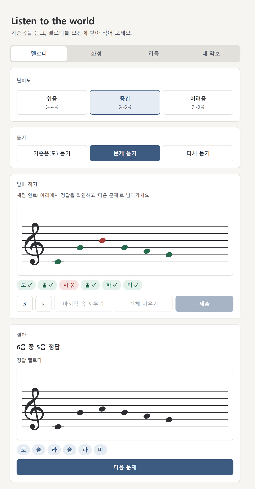
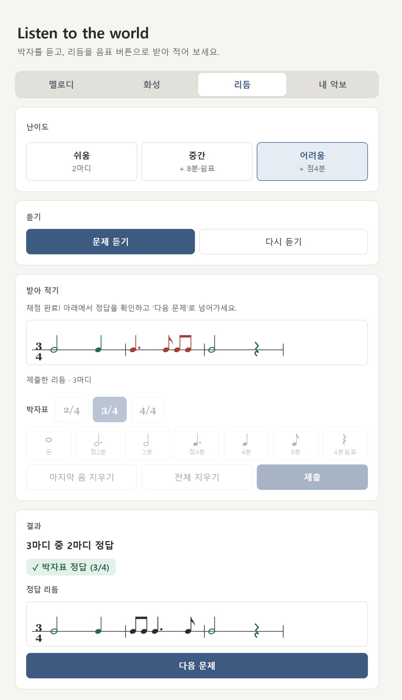
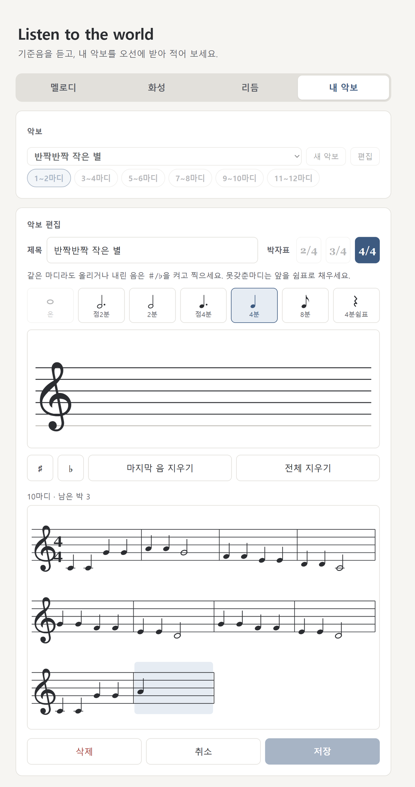
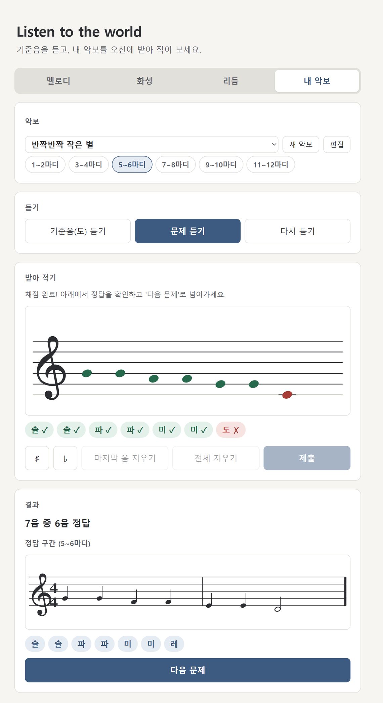
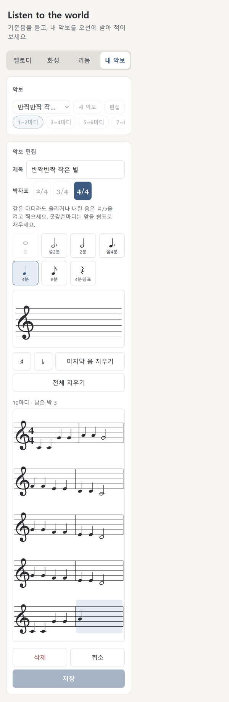

# Listen to the world — 청음 연습 웹앱

> 기준음을 듣고 멜로디·화음·리듬을 받아 적는 청음 연습 사이트. 연습하고 싶은 곡을 직접 악보로 넣어 구간별로 연습할 수도 있다.

- **실행 방법**: `index.html`을 더블클릭해 브라우저로 연다. 서버·설치·로그인이 필요 없다.
- **대상 브라우저**: 데스크톱 Chrome·Edge, 모바일 Chrome
- **만든 기간**: 2026-09-30 ~ 2026-10-08 (커밋 50개)
- **문서**: [요구사항 정의서 docs/PRD.md](docs/PRD.md) · [구현 Todo 리스트 docs/TODO.md](docs/TODO.md)

---

## 1. 제작한 것

### 왜 만들었나

청음은 들리는 소리를 악보로 옮기는 연습이다. 핵심은 소리 하나의 이름을 맞히는 절대음감이 아니라, **기준음(도)을 잡고 그 안에서 계이름을 받아 적는 상대음감 훈련**이다. 혼자 연습하면 문제를 들려주고 채점해 줄 사람이 없다. 이 앱은 문제 듣기, 오선에 받아 적기, 어디가 틀렸는지 확인하기를 버튼 몇 번으로 할 수 있게 한다.

대표 사용자는 레슨 없는 날 집에서 혼자 청음을 연습하는 음대 입시생(가상 인물 "김서연", 18세)으로 잡았다 (PRD 3-1).

### 네 가지 모드

| 모드 | 무엇을 받아 적나 | 난이도·구성 | 완료 |
|---|---|---|---|
| **멜로디** | 기준음 뒤 멜로디의 음높이 (3~8음) | 쉬움 3~4음 / 중간 5~6음 / 어려움 7~8음 | 10-01 |
| **화성** | 화음의 구성음을 오선 한 자리에 쌓기 | 3화음·7화음 각각 쉬움·중간·어려움 (자리바꿈 포함) | 10-04, 10-05 |
| **리듬** | 음표·쉼표의 길이와 박자 | 2마디 → + 8분·쉼표 → + 점4분·박자표 고르기 | 10-06 |
| **내 악보** | 직접 만든 악보의 음높이를 2마디 구간씩 | 악보 편집기, 저장, 구간 칩 | 10-08 |

모든 모드는 같은 흐름을 따른다: **난이도(또는 악보) 고르기 → 듣기 → 받아 적기 → 제출 → 채점과 정답 공개 → 다음 문제**.

- **채점**: 음별·구성음별·마디별로 부분 점수를 주고, 이명동음(도# = 레♭)은 정답으로 인정한다. 틀린 곳은 빨강, 맞은 곳은 초록으로 표시하고 정답을 오선이나 악보로 보여 준다.
- **입력 편의**: 마우스를 올리면 입력될 음이 미리 보이고, 도(C4) 자리에 가이드 선이 있다. 지우기는 마지막 음과 전체 두 가지다. 휴대폰(320px)에서도 손가락으로 줄/칸을 누를 수 있게 크기를 맞췄다.
- **화면 고정**: 모드나 난이도를 바꿔도 "받아 적기" 영역이 위아래로 움직이지 않는다.

### 차별점 — 내 악보 (확장 4)

정해진 문제만 푸는 다른 청음 앱과 달리, **연습하고 싶은 곡을 악보로 직접 입력**해 구간별 청음 문제로 연습할 수 있다.

- **편집기**: 길이 버튼으로 길이를 고르고 오선 입력판을 누르면 음이 붙는다. ♯/♭, 4분쉼표, 2/4·3/4·4/4박자, 최대 12마디까지 넣을 수 있다. 마디는 자동으로 나뉜다.
- **악보 보기**: 기둥 방향, 8분음표 빔, 점, 덧줄을 그린다. 임시표는 표준 표기(마디 안 첫 변화음에만 붙이고, 되돌아가면 ♮)를 따른다.
- **연습**: 악보를 2마디씩 구간으로 나눈다. 기준음 뒤에 구간을 **악보의 리듬대로** 들려주고, 사용자는 음높이를 받아 적는다.
- **저장**: 브라우저(localStorage)에 남는다. 처음에는 예시 악보 "반짝반짝 작은 별"이 들어 있다.

### 화면

<table>
  <tr>
    <td align="center"><br>멜로디 — 채점 결과</td>
    <td align="center"><br>리듬(어려움) — 마디별 채점과 박자표</td>
  </tr>
  <tr>
    <td align="center"><br>내 악보 — 편집기</td>
    <td align="center"><br>내 악보 — 구간 채점과 정답 악보</td>
  </tr>
</table>

<p align="center"><br>휴대폰 폭(375px)</p>

### 기술과 파일 구성

- **HTML / CSS / JavaScript만 사용**한다. `file://`에서도 동작해야 해서 ES 모듈(`import`)과 `fetch`를 쓰지 않았다. 일반 `<script>` 태그로 파일을 붙이고, 문제 데이터도 JS 파일 안에 둔다.
- **소리**는 Web Audio API 합성음이라 음원 파일이 없다. **악보**는 SVG로 직접 그린다.

### 폴더 구조

```
AI-Programming-Assignment/
├── index.html            # 시작 파일 — 더블클릭으로 연다
├── README.md             # 이 문서
├── css/
│   └── style.css         # 디자인, 반응형 배치
├── js/
│   ├── app.js            # 모드 전환, 문제 출제, 재생 연결, 채점, 결과, 내 악보 연습·편집 흐름
│   ├── audio.js          # Web Audio 재생 엔진 (음, 화음, 시각 예약)
│   ├── staff.js          # 오선지 그리기와 클릭 입력 (멜로디·화성·편집기 입력판)
│   ├── rhythm.js         # 리듬 보표, 음표 버튼 입력, 리듬 재생 예약
│   ├── score.js          # 악보 보기, 악보 편집기, 구간 나누기, 구간 재생 예약
│   ├── scores.js         # 악보 저장소(localStorage), 검증, 예시 악보
│   └── data/
│       ├── patterns.js   # 멜로디 문제 (난이도별)
│       ├── chords.js     # 3화음·7화음 문제 (난이도별)
│       └── rhythms.js    # 리듬 문제 (난이도별)
└── docs/
    ├── PRD.md            # 요구사항 정의서
    ├── TODO.md           # 구현 Todo 리스트 (26단계)
    └── images/           # README 화면 캡처
```

- `index.html`은 더블클릭으로 바로 열 수 있도록 맨 위에 두었다.
- 코드는 `css/`·`js/`로, 바꾸지 않는 문제 데이터는 `js/data/`로, 문서(PRD·Todo)와 문서용 이미지는 `docs/`로 나눴다.
- 스크립트는 `index.html`의 `<script>` 순서대로 읽힌다. 바탕이 되는 오선·소리·데이터를 먼저 읽고, 이를 쓰는 `app.js`를 마지막에 읽는다.

---

## 2. PRD와 Todo 리스트

이 프로젝트는 두 문서를 기준으로 진행했다. 코드보다 문서를 먼저 고치고, 문서에 적힌 대로 구현과 테스트를 했다.

### [PRD.md](docs/PRD.md) — 요구사항 정의서

| 항목 | 내용 |
|---|---|
| 목적 | 계이름을 받아 적는 청음 연습 서포트, 확장 4부터는 "내 악보"라는 차별점 |
| 사용자 | 계이름과 오선을 아는 청음 연습자 (페르소나: 음대 입시생) |
| 핵심 기능 | 모드별(4-A 멜로디, 4-B 화성, 4-C 7화음, 4-D 리듬, 4-E 내 악보) 기능, 진행 흐름, 채점 규칙 |
| 범위 밖 | 로그인, 서버 저장, 겹올림표, 16분음표·셋잇단음표, 다른 조성 등 — "만들지 않는 것"을 명시 |
| 기술 조건 | 서버 없이 `file://`로 동작, 일반 `<script>`, localStorage만 사용 |
| 완성 기준 | 1차와 확장 1~4마다 "이러면 성공"을 4~5개씩 정의하고, 날짜와 함께 확인 완료로 표시 |
| 로드맵 | 확장 5 MusicXML 불러오기 → 악보 인식(OCR)·곡 검색 |

기능을 넓힐 때마다(화성, 7화음, 리듬, 내 악보) **PRD를 먼저 고쳐** 범위·흐름·채점 규칙·완성 기준을 정한 뒤에 Todo를 만들었다.

### [TODO.md](docs/TODO.md) — 구현 Todo 리스트

PRD를 **26단계, 체크 항목 453개**로 나눴다. 핵심 규칙은 두 가지다.

1. **모든 [구현] 항목에는 짝이 되는 [테스트] 항목이 있다.**
2. **"완료"는 코딩이 끝난 것이 아니라 테스트까지 통과한 것이다.** 각 항목 옆에 어떻게 확인했는지(자동 테스트 개수, 확인한 폭과 브라우저, 날짜)를 남겼다.

| 범위 | 단계 | 내용 |
|---|---|---|
| 1차 — 멜로디 모드 | 1~6 | 화면 뼈대 → 오선 입력 → 음 재생 → 퀴즈·채점 → 디자인 → 완성 기준 점검 |
| 확장 1 — 화성 모드 | 7~11 | 모드 탭 → 화성용 오선 입력 → 화음 재생 → 화음 데이터·채점 → 점검 |
| 확장 2 — 7화음 | 12~15 | 화음 종류 선택 → 구성음 4개 → 7화음 데이터·이름 → 점검 |
| 확장 3 — 리듬 모드 | 16~20 | 리듬 탭 → 리듬 보표·음표 입력 → 리듬 재생 → 데이터·채점 → 점검 |
| 확장 4 — 내 악보 | 21~26 | 탭·저장소 → 악보 보기 → 편집기 → 구간·재생 → 받아 적기·채점 → 점검 |

Todo 한 단계는 이렇게 생겼다 (23단계 일부):

```markdown
- [x] 23-5 [구현] 마지막 음 지우기 / 전체 지우기, [저장] 조건(제목 + 1마디 이상 + 마지막 마디가 다 참),
      [삭제] 두 번 눌러 확정(다른 버튼을 누르거나 3초가 지나면 확인 상태 풀림), 저장 실패 시 안내
- [x] 23-6 [테스트] 23-5 검증
  - [x] 조건이 맞을 때만 저장이 활성인가 (공백만 있는 제목은 저장 불가, 31자째는 입력되지 않음)
        — 31자째는 브라우저 입력 경로(insertText)로 확인
  - [x] 삭제 버튼을 한 번 누르면 확인 문구로 바뀌고, 다시 눌러야 지워지며, 브라우저 확인창이 뜨지 않는가
  - [x] 마지막 악보를 지우면 연습 화면이 빈 상태 안내("새 악보를 만들어 보세요")를 보이고 에러가 없는가
        — 23단계 자동 테스트 55개 항목, 320~1000px 11개 폭 × Edge·Chrome(file://) 모두 통과 ...
```

---

## 3. 개발 방법론

이 과제는 바이브 코딩(AI에게 자연어로 지시해 코드를 만드는 방식)으로 진행했다. 여기서 "방법론"은 **AI와 함께 이 앱을 만든 작업 방식**을 말한다. 한 문장으로 줄이면 다음과 같다.

> **문서 주도 · 단계별 · 테스트로 완료를 판정하는 바이브 코딩**
> PRD로 범위를 정하고, Todo로 잘게 나누고, AI가 한 단계씩 구현과 테스트를 하고, 사람이 확인하고 커밋한다.

```
 PRD 작성/수정 ──▶ Todo 분해 ──▶ 계획 검토 ──▶ ┌─ 단계 실행 (AI: 구현 + 자동 테스트)
 (범위·완성 기준)   ([구현]+[테스트])  (빈칸 찾기)   │        │
                                                │        ▼
                                                │  보고 (완료 번호 + 테스트 근거)
                                                │        │
                                                │        ▼
                                                │  사람 확인 (청취·실제 기기) → 직접 커밋
                                                └─ 다음 단계 ◀─┘
                                                         │ 확장의 마지막 단계
                                                         ▼
                                              완성 기준 점검 → 완료 선언
```

1. **PRD 작성**: 목적·사용자·기능·범위 밖·완성 기준을 적는다. 확장할 때마다 PRD부터 고쳤다.
2. **Todo 분해**: 단계와 항목으로 나누고, [구현]마다 [테스트]를 짝지었다.
3. **계획 검토**: 구현 전에 AI가 계획을 실제 코드와 맞춰 보고 빈칸을 찾았다. 확장 4에서는 이 검토로 PRD와 TODO를 고친 뒤 시작했다.
4. **단계 실행**: AI가 한 단계의 코드를 쓰고, 헤드리스 Edge·Chrome으로 자동 테스트를 돌렸다. 테스트는 `file://`로 연 페이지를 320~1000px 11개 폭에서 돌린다. 실제 Chrome 창에서도 마우스로 확인했다.
5. **보고와 커밋**: AI는 "완료한 번호 + 테스트 결과"를 보고하고 멈춘다. 사람이 확인한 뒤 직접 커밋한다("N단계 코드 생성 및 테스트 완료").
6. **사람만 할 수 있는 확인**: 소리 듣기(🔈), 데스크톱 Edge 실제 창, `index.html` 더블클릭 실행, 실제 휴대폰은 사람이 확인했다.
7. **완성 기준 점검**: 확장마다 마지막 단계(6·11·15·20·26단계)에서 PRD의 완성 기준을 하나씩 확인하고 완료를 선언했다.

| 사람 | AI |
|---|---|
| 무엇을 만들지 정하기 (확장 순서, 범위, 차별점) | PRD·Todo 초안, 계획 검토 |
| 기획과 계획 승인, 단계마다 결과 확인 | 구현, 자동 테스트 작성·실행 |
| 소리·실제 기기·더블클릭 실행 확인 | 화면 캡처와 실제 Chrome 창 점검 |
| 커밋 | 단계별 보고 (근거와 한계 포함) |

---

## 4. 방법론의 장단점

### 장점

**① 범위가 흔들리지 않았다.**
PRD에 "만들지 않는 것"과 완성 기준이 있었다. 덕분에 기능을 네 번 넓히는 동안에도 "이번엔 어디까지"가 분명했다. 확장마다 기존 모드의 한 사이클을 회귀 테스트로 다시 돌려, 뒤늦게 기존 기능이 깨지는 일을 막았다.

**② 테스트가 사람이 놓치기 쉬운 버그를 실제로 잡았다.**
"테스트까지 통과해야 완료" 규칙과 여러 화면 폭 검사가 이런 문제를 찾아냈다.

| 단계 | 찾은 문제 | 처리 |
|---|---|---|
| 16 | 482~680px 폭에서 멜로디↔화성을 바꾸면 오선지가 56px 어긋남 (이전부터 있던 문제) | 듣기 버튼 2열 배치 기준을 480 → 680px로 넓힘 |
| 17 | 481~560px에서 리듬 보표 4마디가 한 줄에 들어가 8분음표가 겹침 | 줄 나눔 기준을 화면 폭 대신 보표 상자 폭으로 바꿈 |
| 22 | 아래로 난 기둥의 8분음표 꼬리가 거꾸로 달림 | 방향을 고치고 꼬리 방향 테스트를 추가 |
| 23 | 입력 중인 마디의 강조 상자가 오선을 가림 | 강조 상자를 오선 뒤로 |
| 24 | 데스크톱에서 구간 칩 줄의 스크롤바가 칩 높이를 줄임 | 스크롤바를 숨기고 마우스 휠로 가로 스크롤 |

**③ 작은 단계와 사람의 커밋으로 통제가 쉬웠다.**
단계가 작아 결과를 확인하기 쉬웠고, 단계마다 커밋이 되돌릴 지점이 됐다. 진행 중에 사람이 낸 요청도 Todo 항목으로 바로 들어가 같은 규칙(구현 + 테스트)으로 처리됐다. 화성 모드(원래 범위 밖이던 기능을 확장 1로 추가)와 아주 작은 화면(320px) 보정이 그런 예다.

**④ 구현 전에 명세의 빈칸을 찾았다.**
확장 4 시작 전 계획 검토에서 이런 빈칸이 나왔다.
- **임시표 규칙**: 실제 악보에서는 임시표가 마디 끝까지 이어진다. 이 규칙이 없으면 사용자가 악보에 보이는 대로 적었을 때 틀린 정답이 저장된다.
- **8마디 상한**: 예시 곡이 12마디라 중간에 잘린다.
- **못갖춘마디**: 지금 규칙으로는 적을 수 없다.

이를 PRD에 반영하고 시작해서, 구현 후에 고치는 비용을 줄였다.

**⑤ 근거가 문서에 남는다.**
TODO의 각 항목에 테스트 개수, 확인한 폭과 브라우저, 날짜, 그리고 확인하지 못한 것까지 적었다. 나중에 무엇이 어떻게 검증됐는지 다시 볼 수 있다.

### 단점·한계

**① AI는 소리를 들을 수 없다.**
자동 테스트는 "몇 초에 어떤 높이의 음이 예약되는가"까지만 확인한다. 탁하지 않은지, 리듬이 자연스러운지는 매번 사람이 직접 들어야 했다(🔈 청취 확인 항목).

**② 실제 기기 확인에 한계가 있었다.**
- 휴대폰 폭은 주로 헤드리스 브라우저의 좁은 틀로 확인했다.
- 실제 Chrome 창이 최대화 상태라 폭을 줄이지 못하거나, 최소화 상태라 캡처가 실패한 적이 있었다.
- 데스크톱 스크롤바 자리(15px) 때문에 320px에서 잰 값이 휴대폰과 달라, 측정 조건을 따로 정리해야 했다.

**③ 테스트도 AI가 썼다.**
테스트 데이터가 틀려 거짓 실패가 난 적이 여러 번 있었다(예: "정확히 8음" 시험 악보가 실제로는 9음). 테스트는 실패 원인을 하나하나 확인해 걸렀지만, 구현과 테스트를 같은 AI가 쓰면 같은 오해를 공유할 위험이 남는다.

**④ 문서와 절차에 드는 비용이 크다.**
TODO는 약 700줄이 됐다. 단계마다 보고·확인·커밋을 기다려야 해서, 한 번에 몰아서 만드는 것보다 느리다.

**⑤ 세션이 바뀌면 맥락이 끊긴다.**
대화가 새로 시작되면 이전 맥락과 임시 폴더의 테스트 러너가 사라졌다. 메모와 지난 기록을 다시 찾아야 했다. 자동 테스트 코드가 저장소에 남아 있지 않은 것도 같은 이유다.

**⑥ 브라우저 환경 문제가 섞여 든다.**
로컬 서버로 확인할 때 브라우저가 예전 파일을 캐시에서 써서 `RHYTHMS is not defined` 오류가 난 적이 있다(앱 문제가 아니었다). 실제 창에서 페이지를 연 직후 첫 클릭이 무시된 일도 있었다. 이런 일은 앱 버그와 가려내는 데 시간이 든다.

---

## 5. 개선이 필요한 점

### 앱

- **악보 넣는 방법 넓히기**: 지금은 직접 입력만 된다. MusicXML 불러오기(확장 5) → 악보 인식(OCR)·곡 검색 순서로 넓힐 계획이다 (PRD 11번).
- **악보 범위**: 다장조, C4~G5 음역, 2/4·3/4·4/4박자, 최대 12마디만 된다. 다른 조성, 낮은음자리표, 못갖춘마디, 8분쉼표, 붙임줄, 16분음표·셋잇단음표를 넣을 수 없다.
- **연습 종류**: 선율(음높이 + 리듬) 받아 적기, 화성 진행(여러 화음 연속) 받아 적기가 없다.
- **기록**: 진행 기록과 정답률 통계가 없다. 악보 파일 내보내기와 기기 간 동기화가 없다(같은 브라우저 안에서만 저장).
- **사용성**:
  - 데스크톱에서는 구간 칩 줄의 스크롤바를 숨겨, 칩이 더 있다는 것이 잘 드러나지 않는다.
  - 실제 휴대폰 여러 기종에서 더 시험해야 한다.

### 개발 과정

- **테스트를 저장소에 넣기**: 헤드리스 테스트 러너와 단계별 테스트를 `tests/` 등으로 옮겨, 누구나 다시 돌릴 수 있게 한다.
- **사람이 정한 시험 사례**: 사람이 미리 정답을 정해 둔 시험 악보와 채점 사례(골든 데이터)를 두어, AI가 쓴 테스트를 교차 검증한다.
- **세션 간 인계**: 단계가 끝날 때마다 "다음 세션이 알아야 할 것"(실행 방법, 주의점)을 문서로 남겨 맥락이 끊기는 비용을 줄인다.

---

## 6. 결론

약 열흘 동안 멜로디 모드에서 시작해 화성, 7화음, 리듬, 내 악보까지 **네 번 확장**했다. 결과는 **26단계, 체크 항목 453개, 커밋 50개**이고, 서버 없이 `index.html` 하나로 동작한다. 마지막 확장인 "내 악보"로 정해진 문제를 푸는 데서 나아가, 자기가 연습하고 싶은 곡으로 청음을 연습할 수 있게 됐다.

이번 바이브 코딩에서 가장 효과가 컸던 것은 **"완료 = 테스트 통과"라는 규칙과 작은 단계**였다. AI가 빠르게 코드를 만들어도, 문서로 범위를 정하고 테스트로 완료를 판정하고 사람이 확인해서 커밋하니 결과를 믿을 수 있었다. 여러 화면 폭을 기계적으로 검사한 덕분에 사람 눈으로는 놓치기 쉬운 배치 문제도 잡았다.

반대로 AI가 대신할 수 없는 부분도 분명했다. 소리를 듣는 일, 실제 기기에서 써 보는 일, 그리고 **무엇을 만들지 정하는 일**은 끝까지 사람의 몫이었다. 바이브 코딩에서도 사람의 역할은 코드를 쓰는 사람에서 **방향을 정하고 결과를 확인하는 사람**으로 바뀔 뿐, 사라지지 않는다는 것을 확인했다.

다음 단계로는 MusicXML 불러오기(확장 5)를 통해, 직접 입력하지 않아도 가진 악보로 바로 연습할 수 있게 하는 것을 생각하고 있다.
